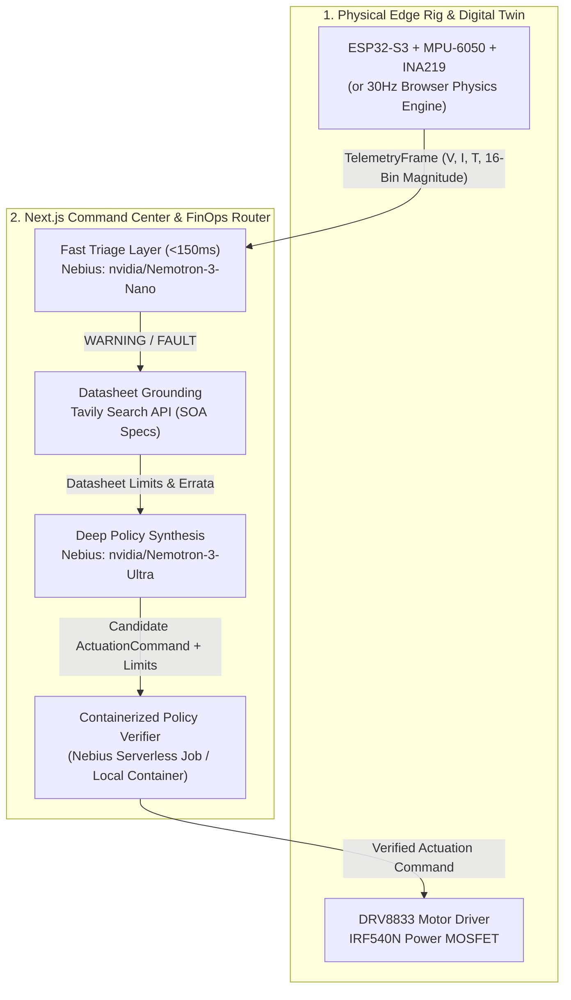

# HarmoniQ: Edge-to-Cloud Physical AI Fault Recovery
**Physical AI Track** | **Nebius x NVIDIA Global AI Hackathon**

> **Elevator Pitch:** Closed-loop Physical AI agent that triages real-time MCU vibration & voltage telemetry with Nemotron Nano, diagnoses faults via Tavily & Nemotron Ultra on Nebius, and autonomously stabilizes hardware.

[](LICENSE)
[](https://nextjs.org/)
[](https://nebius.com/token-factory)
[](https://tavily.com/)

**Demo Video:** TODO, add link before submission  
**Live Command Center:** TODO, add deployed URL (local: `http://localhost:3000`)

---

## 1. Executive Summary

**HarmoniQ** delivers an embodied, closed-loop **Physical AI** predictive maintenance and fault recovery agent. Operating across the edge-to-cloud spectrum, the system:
1. Ingests high-frequency (30Hz) microcontroller telemetry (16-bin vibration magnitude spectrum, supply voltage, current draw, and power stage temperature).
2. Performs sub-150ms anomaly classification via **NVIDIA Nemotron Nano/Lightning** on **Nebius Token Factory**.
3. Grounds diagnostics in real-world manufacturer component datasheets via **Tavily Search API** to extract safe operating area (SOA) curves, thermal derating factors, and supply brownout limits.
4. Synthesizes safe parameter adjustments using **NVIDIA Nemotron Ultra/Super** on Nebius Token Factory.
5. Verifies stability in a **containerized state-space verifier** -- dispatched as a **Nebius Serverless Job** when configured, otherwise the exact same container entrypoint runs locally -- before dispatching corrective actuation commands (`SET_PWM`, `RECALIBRATE_PID`, `ENGAGE_CURRENT_LIMIT`, `EMERGENCY_CUTOFF`) back to stabilize the rig in real time.

Every external integration has a deterministic local fallback, so the full closed loop runs zero-config with no API keys or hardware attached.

---

## 2. What is Real vs. Simulated

| Subsystem | Real Hardware / Cloud Path | Simulation / Fallback Path |
|---|---|---|
| **Telemetry & Ingestion** | Real `ESP32-S3` MCU sampling `MPU-6050` IMU and `INA219` current monitor over I2C, streaming over USB serial via `hardware/edge-bridge/bridge.ts` (`HARDWARE_LIVE`). | 30Hz discrete physics Digital Twin in browser / Node runtime modeling rotor inertia, Joule heating, and bearing harmonic resonance (`SYNTHETIC_TWIN`). |
| **Spectral Analysis** | 16-sample vibration magnitude shift register in ESP32 firmware (`computeFFT16`) tracking peak harmonic energy. | 16-bin discrete harmonic generator simulating fundamental (120Hz) and bearing wear fault harmonics (385Hz). |
| **Agent Inference** | Real **NVIDIA Nemotron Nano** (`/api/telemetry`) & **Nemotron Ultra** (`/api/diagnose`) hosted on Nebius Token Factory with OpenAI-compatible streaming. | Deterministic rule-based triage and grounded synthesis fallback with zero API keys required (`FALLBACK_SIM`). |
| **Datasheet Grounding** | Real-time live query to **Tavily Search API** retrieving manufacturer datasheet PDFs and SOA curves. | Curated offline datasheet knowledge base with verified parameters from TI, Vishay, and InvenSense. |
| **Policy Verification** | Remote **Nebius Serverless Job** running the containerized verifier image (`/ai/v1/jobs`) or local Python subprocess (`verifier.py`). | In-process TypeScript state-space verification engine (`src/lib/simulator.ts`), mathematically identical to the Python container. |

---

## 3. Hackathon Rules & Technical Compliance Matrix

| Hackathon Requirement | Implementation in This Repository | Source Files |
|---|---|---|
| **Nebius Infrastructure** (`api.tokenfactory.nebius.com/v1` & Serverless Jobs) | OpenAI-compatible client pointed at `https://api.tokenfactory.nebius.com/v1` with dynamic `/v1/models` resolution (restricted strictly to Nemotron/NVIDIA models), plus a backend dispatcher that runs the containerized Python verifier as a real **Nebius Serverless Job** (`/ai/v1/jobs`) when configured. | [`src/lib/nebius.ts`](src/lib/nebius.ts), [`src/lib/verifier-job.ts`](src/lib/verifier-job.ts), [`jobs/policy-verifier/Dockerfile`](jobs/policy-verifier/Dockerfile) |
| **NVIDIA Open-Source Models** (`Nemotron` family) | Multi-tier routing between **NVIDIA Nemotron Nano / Lightning** (Tier-1 `<150ms` triage) and **NVIDIA Nemotron Ultra / Super** (Tier-2 root-cause policy synthesis), with validated structured JSON output. | [`src/lib/nebius.ts`](src/lib/nebius.ts), [`src/app/api/telemetry/route.ts`](src/app/api/telemetry/route.ts), [`src/app/api/diagnose/route.ts`](src/app/api/diagnose/route.ts) |
| **Tavily Search Integration** | Runtime `POST https://api.tavily.com/search` call inside `/api/diagnose` retrieving manufacturer datasheet SOA limits and thermal derating curves for `IRF540N`, `DRV8833`, `MPU6050`, and `INA219`, feeding numeric limits into the state-space verifier. | [`src/lib/tavily.ts`](src/lib/tavily.ts), [`src/components/AgentTracePanel.tsx`](src/components/AgentTracePanel.tsx) |
| **Physical AI Track & 1-Minute Video Rule** | Includes both `ESP32-S3` C++ firmware + Serial bridge (`HARDWARE_LIVE`) and a 30Hz closed-loop physics Digital Twin (`SYNTHETIC_TWIN`) so judges can test fault injection and autonomous stabilization live in the browser. The bridge can inject faults on a schedule via CLI flags. | [`hardware/firmware/esp32_telemetry_rig.ino`](hardware/firmware/esp32_telemetry_rig.ino), [`hardware/edge-bridge/bridge.ts`](hardware/edge-bridge/bridge.ts), [`src/lib/digital-twin.ts`](src/lib/digital-twin.ts) |
| **Open-Source License Rule** | Explicit **MIT License** at repository root (`LICENSE`) and in `package.json` (`"license": "MIT"`). | [`LICENSE`](LICENSE), [`package.json`](package.json) |

---

## 4. System Architecture & Data Flow



---

## 5. Key Engineering Innovations

### A. Two-Tier FinOps Model Routing on Nebius Token Factory
High-frequency physical telemetry generates tens of thousands of frames per hour. Running deep reasoning models on every nominal frame is economically unviable and introduces unnecessary latency:
* **Tier 1 (Fast Triage):** Evaluates incoming telemetry in `<150ms` using `nvidia/Nemotron-3-Nano-30B` (or `nvidia/Llama-3_1-Nemotron-Nano-8B-v1` / `nvidia/Nemotron-3_5-Lightning`) at low temperature (`0.1`). When evaluated on periodic samples (e.g. 1.2s cadence) and anomalous frames, it filters nominal frames before escalation.
* **Tier 2 (Deep Reasoning):** Only when an anomaly occurs is `nvidia/Nemotron-3-Ultra-550b-a55b` (or `nvidia/Llama-3_1-Nemotron-Ultra-253B-v1`) invoked, cross-referencing live manufacturer datasheet constraints to generate a recovery policy.
* **Estimated FinOps Savings:** The command center tracks an estimated cost savings metric assuming an Ultra token pass costs ~$0.006 and a Nano triage costs ~$0.0001 (a ~$0.0059 savings per filtered call), displayed directly with explicit price assumptions in the instrumentation header.

### B. Live Hardware Datasheet Grounding via Tavily
Generic LLMs frequently hallucinate safe operating limits. Our agent queries **Tavily Search API** in real time for the exact hardware Bill of Materials (BOM):
* **IRF540N N-MOSFET:** Retrieves linear thermal derating curves (`1.0 W/°C above 25°C`) and triggers automatic PWM derating when junction temperature exceeds the 85°C continuous design derating margin (datasheet Tj max 175°C).
* **DRV8833 Dual H-Bridge:** Identifies 8.5V system brownout threshold and commands current limiting during inductive brownout transients.
* **MPU-6050 Accelerometer:** Pinpoints bearing outer-raceway defect harmonics (`385Hz`) and computes PID damping parameters.
* **Dynamic Limit Grounding:** Extracted datasheet limits are passed directly to the state-space verifier as boundary constraints.

### C. Containerized Policy Verification with Graceful Backends
Autonomous actuation commands are dangerous without validation. Before any command touches physical actuators, `/api/simulate` runs a forward discrete-time state-space simulation (50 steps, 2.5s horizon) that blocks any policy violating the thermal, current, or vibration boundaries.

`verifyPolicyWithDispatch()` ([`src/lib/verifier-job.ts`](src/lib/verifier-job.ts)) picks the strongest available backend and reports which one actually ran in `SimulationResult.verifierBackend`:

1. **`NEBIUS_SERVERLESS_JOB`** -- opt-in. With `NEBIUS_VERIFIER_REMOTE=true` and the job config below set, it submits `jobs/policy-verifier` to `https://api.nebius.cloud/ai/v1/jobs`, injects the frame/command as a file, and polls the job's terminal state. The container exits non-zero on unsafe policies, so job `COMPLETED` vs `FAILED` is the authoritative pass/fail gate.
2. **`LOCAL_CONTAINER`** -- the default when Python is on `PATH`. Runs the exact same `verifier.py` entrypoint as a subprocess, so the shipped container logic is exercised rather than reimplemented.
3. **`LOCAL_STATE_SPACE`** -- the in-process TypeScript engine ([`src/lib/simulator.ts`](src/lib/simulator.ts)), kept mathematically identical to the Python verifier. Used when Python is unavailable.

The UI never labels a result with a backend that did not run.

---

## 6. Hardware Bill of Materials (BOM) & Pinout

| Component | Part Number | Category | Interface / Pinout | Operational Limit |
|---|---|---|---|---|
| **Microcontroller** | ESP32-S3-WROOM-1 | Dual-Core 240MHz MCU | USB Serial @ 115200 baud | 3.3V Logic |
| **Vibration Sensor** | MPU-6050 | 6-DoF Accelerometer / IMU | I2C (SDA: GPIO 21, SCL: 22) | Peak &lt; 0.40g RMS |
| **Power Monitor** | INA219BIDR | Zero-Drift Shunt Monitor | I2C (Address 0x40) | Continuous &lt; 2.5A |
| **Motor Driver** | DRV8833PWP | Dual H-Bridge Driver | PWM IN1: GPIO 18, IN2: 19 | System Brownout &gt;= 8.5V (VM UVLO 2.6V falling) |
| **Switching MOSFET** | IRF540NPBF | 100V 33A N-Channel MOSFET | Gate: PWM Channel 0 | Design margin &lt;= 85°C (datasheet Tj max 175°C) |
| **Safety Relay** | 5V Optocoupled Relay | Hardware E-Stop | GPIO 23 (Active LOW) | Emergency Isolation |

---

## 7. Live Demo Video Reproduction Guide

The submission video shows the agent responding to the physical rig in real time. You can reproduce the demo with or without hardware; the steps below use the software Digital Twin for simulation:

1. **Launch the Command Center:**
   ```bash
   npm run dev
   ```
   Open `http://localhost:3000` in your browser.

2. **Verify Nominal Telemetry Stream:**
   Watch the dual-channel oscilloscope plot nominal traces (`12.1V` rail, `41°C` temperature, `120Hz` fundamental vibration peak). The top FinOps bar shows `Triage Filtered: 100%`, and the reasoning log streams live Tier-1 nominal checks.

3. **Induce a Physical Fault:**
   Click **1. Bearing Wear**, **2. Brownout**, or **3. Thermal Runaway** on the control deck.
   * Rail, vibration harmonic, or temperature immediately departs the nominal zone (`>105°C` or `385Hz` harmonic).
   * Status transitions to `FAULT` (crimson indicator).

4. **Observe the Autonomous Agent Trace:**
   Within sub-seconds, the **Autonomous Agent Reasoning Trace** displays:
   * **Stage 1 (Triage):** Flags the fault in `<150ms`.
   * **Stage 2 (Tavily Grounding):** Retrieves manufacturer datasheet derating limits with clickable citation URLs.
   * **Stage 3 (Ultra Synthesis):** Formulates a recovery command (`SET_PWM`, `ENGAGE_CURRENT_LIMIT`, or `RECALIBRATE_PID`).
   * **Stage 4 (Sandbox Verify):** The containerized verifier tests the policy in the 50-step state-space sandbox against extracted limits and reports which backend actually ran (`NEBIUS_SERVERLESS_JOB`, `LOCAL_CONTAINER`, or `LOCAL_STATE_SPACE`).
   * **Stage 5 (Actuation Dispatch):** Dispatches the verified command to the rig.

5. **Witness Autonomous Stabilization:**
   Over the next 2 to 3 seconds, the live oscilloscope curve physically stabilizes, temperature/voltage/vibration returns inside the Safe Operating Area, and the status returns to `NOMINAL`.

---

## 8. Local Setup & Quickstart

### Prerequisites
* Node.js 18+ (Node 20 recommended)
* Python 3.10+ (optional: runs the local container verifier and `npm run verify:job`; without it the app falls back to the in-process TypeScript engine)

### Installation
```bash
# Install dependencies
npm install

# Copy environment variables
cp .env.example .env.local
```

### Configure Keys (`.env.local`)
```env
# Nebius Token Factory (OpenAI-compatible inference)
NEBIUS_API_KEY="your_nebius_token_factory_key"
NEBIUS_BASE_URL="https://api.tokenfactory.nebius.com/v1"

# Tavily (datasheet grounding)
TAVILY_API_KEY="tvly-your_tavily_api_key"
```
*(If keys are omitted, the app runs zero-config using deterministic local physics and curated manufacturer specifications.)*

To dispatch the verifier as a real **Nebius Serverless Job** instead of running it locally, also set:
```env
NEBIUS_VERIFIER_REMOTE="true"
NEBIUS_PROJECT_ID="your_nebius_project_id"
NEBIUS_IAM_TOKEN="<access token from: nebius iam get-access-token>"
NEBIUS_JOB_IMAGE="<registry/path:tag of the pushed jobs/policy-verifier image>"
NEBIUS_JOB_PLATFORM="<serverless platform ID>"
NEBIUS_JOB_PRESET="<preset matching the platform>"
# NEBIUS_JOB_SUBNET_ID=""
# NEBIUS_JOB_POLL_BUDGET_MS="45000"
# NEBIUS_JOB_POLL_INTERVAL_MS="2000"
```

### Run Verification & Start Server
```bash
# Self-test the policy verifier container
npm run verify:job

# Run the end-to-end closed-loop pipeline smoke test
npm run smoke-test

# Start the Command Center
npm run dev
```

### Stream synthetic edge telemetry (optional)
Drive the API from a separate process instead of the browser loop. The bridge can also inject faults on a schedule so the `HARDWARE_LIVE` path exercises recovery without a physical rig:
```bash
npm run bridge:synthetic
npm run bridge:synthetic -- --fault THERMAL_RUNAWAY --fault-after 5 --hold 15 --cycle
```
Supported faults: `BEARING_WEAR`, `VOLTAGE_BROWNOUT`, `THERMAL_RUNAWAY` (see `hardware/edge-bridge/bridge.ts`).

### Note on Production Deployment
If hosting the Next.js command center publicly, prefer a long-running container or Node.js host (e.g. Docker, VPS, Railway, Render) over ephemeral serverless lambdas so the in-memory telemetry ring buffers, agent traces, and FinOps counters persist across user interactions.

---

## 9. License

This project is licensed under the **MIT License**. See the [LICENSE](LICENSE) file for details.
